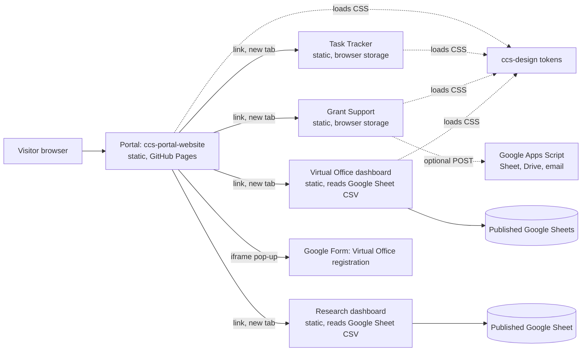
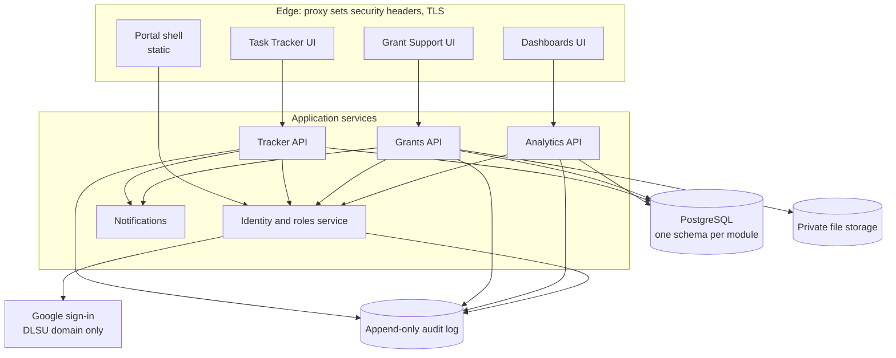

# CCS Commons: Architecture

**Status:** Draft for approval, 2026-10-19. Sections 2 and 3 describe the system as it is. Sections 4 to 12 are **Proposed**
and change nothing until the owner approves them. Labels are defined in [PRD.md](PRD.md).

## 1. Principles (Proposed)

1. **Continue, do not rebuild.** The static portal stays. New capability is added behind it.
2. **Modules are independent.** Each can be built, tested, deployed and rolled back alone, and each follows one contract.
3. **The server decides access.** Hiding a button is never protection. Every protected request is checked on a server.
4. **Least data.** Show totals, collect only what a task needs, keep it only as long as needed.
5. **One design, one identity.** Tokens and sign-in are shared, not copied.
6. **Evidence before claims.** A control is described as working only after it has been tested.

## 2. Current system

### 2.1 Components

### 2.2 Facts

| Topic | Today | Label |
| --- | --- | --- |
| Portal stack | HTML, CSS, JavaScript. No framework, bundler or package manager. | Existing (verified) |
| Hosting | GitHub Pages, deployed by a workflow on push to `main`. HTTPS is enforced. | Existing (verified) |
| Origin | The portal and all module sites are served from `https://zefanonuevo.github.io/...`, so they share one browser origin and one `localStorage`. | Existing (verified by URL) |
| Authentication | None on the portal. Tracker and grants accept a demo password in the browser. The VO dashboard compares a SHA-256 hash in the browser against `users.json`, which is served publicly. The research dashboard has none. | Existing (verified by reading code; not tested) |
| Authorization | The access matrix lives in `assets/js/config.js` and only drives preview badges. | Existing (verified) |
| Data | Browser `localStorage` and IndexedDB (tracker, grants). Published Google Sheets read as CSV (VO and research dashboards). Content for programs and departments is embedded in pages and in `programs.js`. | Existing (verified by reading) |
| Backend | None. The only server-side code is an optional Google Apps Script in `ccs-scgss/google/Code.gs`, deployed by the owner. Its comments describe it as a shared token, "not a user sign-in". | Existing (verified by reading); deployment not inspected |
| Security headers | No Content-Security-Policy meta tag on any of the 14 pages. GitHub Pages cannot set response headers. | Existing (verified) |
| Analytics and tracking | No analytics script found in the portal. | Existing (verified by search) |
| Tests and CI | None, apart from the deploy workflow. | Existing (verified) |
| Registration | Google Form opened in an iframe pop-up with a "new tab" fallback. | Existing (verified by reading); not tested |

### 2.3 What is not true today

- There is no server-side access control, so no role restriction is enforced anywhere.
- There is no database, audit trail or backup for module data.
- Nothing here has been security-reviewed.

## 3. Constraints and assumptions

- DLSU data privacy rules apply (Philippines Data Privacy Act). The Data Protection Officer must review before real personal data is stored. **Decision needed.**
- DLSU Google accounts exist for staff and students. Whether the college can restrict sign-in to the DLSU domain and read the student list is **unconfirmed**.
- Hosting for any server code is not decided (D2). Candidate: a CCS-managed VM. The CCS cloud manuals in the artifact list suggest such infrastructure exists; **not inspected**.

## 4. Target architecture (Proposed)

Phasing: nothing in this diagram is built. Implementation-Plan.md introduces it step by step. The static portal keeps working
throughout, and sections 5 to 10 can be adopted one at a time.

## 5. Technology stack (Proposed)

| Layer | Recommendation | Why |
| --- | --- | --- |
| Portal shell | Keep static HTML, CSS and JavaScript. Move shared logic into small ES modules if it grows. No framework unless a module needs one. | Already works, no build to maintain, easy to host anywhere. |
| Module UIs | Each module chooses its tooling, but must meet the contract (section 8). Today all are single static pages. | Independence. |
| Backend | Node.js LTS with TypeScript. REST API described in OpenAPI. | Matches team skills implied by the existing JavaScript; type safety; common hosting. **Decision needed (D2).** |
| Database | PostgreSQL with versioned migrations. One schema per module. No cross-schema reads. | Transactions, constraints, row-level control, mature backups. |
| Files | Private storage. Files served only through authorized links. | Grant documents contain personal data. |
| Identity | Google OpenID Connect restricted to the DLSU domain. Roles from our own tables, never from the Google profile alone. | One account, no passwords to manage (v2 blueprint). **Decision needed (D3).** |
| Sessions | Server-set, HttpOnly, Secure, SameSite cookies. No tokens in `localStorage`. | Limits theft by scripts. |
| Email | Queue with an idempotency key per event so one event sends one email. | Avoids duplicates (carried from the grants review). |
| Reports | Generated from stored data; each copy stored with its application. | Auditability. |
| Tooling | Linting, formatting, unit and end-to-end tests, dependency and secret scanning in CI. | Baseline absent today. |

Not recommended: Google Forms or Sheets as the system of record for workflows with roles and audit needs. They remain
valid for import and export, and for the existing registration form.

## 6. Authentication and authorization (Proposed)

**Authentication.** One sign-in for the portal and every module. The server verifies the Google ID token, checks the
domain, then looks up the person in the directory.

**Directory.** A table of people with email, DLSU ID, program, department and status. Source is **D11**. Anyone not in it is a Guest.

**Roles, two levels:**

| Level | Values | Where it is used |
| --- | --- | --- |
| Coarse role | Guest, Student, Faculty, Staff, Admin | Portal visibility, the access matrix (PRD.md section 2.1) |
| Module role | Tracker: requester, office assistant, office coordinator, unit head. Grants: student, thesis adviser, department chair, associate dean, dean, administrative assistant, secretary, system administrator. Dashboards: designated admin per dashboard. | Actions inside a module |

A person can hold one coarse role and several module roles. Module roles are assigned by a designated administrator, and every
assignment change is audited. The Admin coarse role alone never grants dashboard access: dashboards require designation (D10).

**Authorization rules**
1. Deny by default. Every API call checks coarse role, module role and ownership on the server.
2. Nobody approves or acts on their own record (grants rule, carried from the review).
3. Approvals follow the stated order and are recorded; returning a file keeps prior decisions.
4. Dashboard data is aggregated on the server. Browsers receive totals, never rows with names.

## 7. Security requirements (Proposed)

None of these controls exists yet. They become requirements for any phase that stores real data.

| # | Requirement |
| --- | --- |
| S1 | Server-side authentication and authorization on every protected route; tests prove deny-by-default. |
| S2 | No secrets, tokens or personal data in any repository, including `users.json` and sheet links with private content. |
| S3 | Replace published-to-web Google Sheets with authenticated, server-side reads (service account) for any sheet containing personal data. |
| S4 | Apps Script endpoints (if kept) verify the signed-in Google user on every request. Shared tokens are not accepted for real data. |
| S5 | Security headers on every response: CSP, `frame-ancestors`, `X-Content-Type-Options`, HSTS, referrer policy. Needs a host that can set headers. |
| S6 | Input validation and output encoding on all user-supplied data. Never insert user content with `innerHTML`. |
| S7 | File uploads: type and size limits, malware scanning, private storage, authorized download links. |
| S8 | Audit log (append-only) for sign-ins, role changes, approvals, exports and dashboard views. |
| S9 | Rate limiting and lockout on sign-in and form endpoints. |
| S10 | Dependency, secret and static analysis in CI; no build is shipped with known critical findings. |
| S11 | Backups, restore tests, and a documented incident process. |
| S12 | Privacy: data minimization, retention periods (D17), small-group suppression (D16), consent for publication records (D14), Data Protection Officer review. |
| S13 | A security review before each phase that handles real data (Implementation-Plan.md). |

### 7.1 Known weaknesses today (not controls, findings)

| # | Finding | Evidence |
| --- | --- | --- |
| W1 | VO dashboard login runs in the browser; `users.json` is public. It does not protect the dashboard or the sheets it reads. | `assets/auth.js`, `assets/users.json` in `ccs-vo-dashboard` |
| W2 | The research dashboard has no login, while the access matrix says statistics dashboards are Admin only. | `ccs` repo, public Pages site |
| W3 | Sheet addresses are in public source files. Whether the sheets contain personal data was **not inspected**. | `CSV_URL` in `assets/app.js`, `assets/evaluation.js` |
| W4 | Apps Script is deployed as "Anyone" with a shared token (by its own setup comments). | `ccs-scgss/google/Code.gs` |
| W5 | All sites share the origin `zefanonuevo.github.io`, so a script flaw in one site can read the browser storage of the others. | URL structure |
| W6 | No CSP on any page. | Search of the 14 pages |

## 8. Module independence and the module contract (Proposed)

A module is any application the portal links to. To stay compatible with the portal it must meet this contract.

| # | Contract item | Detail |
| --- | --- | --- |
| 1 | **Own repository and release** | Own repo, semantic version, tagged releases, changelog. |
| 2 | **Own deployment** | Can be deployed, rolled back and taken down without touching the portal. |
| 3 | **Manifest** | A `module.json` the portal reads: `id`, `name`, `door`, `version`, `url`, `requiredRole`, `status`, `contact`, `contractVersion`. The portal's `modules` object in `config.js` is the starting point. |
| 4 | **Identity** | Accepts the shared sign-in. Reads coarse role from the verified session; stores its own module roles. |
| 5 | **Authorization** | Enforced by its own server. The portal never decides on a module's behalf. |
| 6 | **Data** | Owns its schema. Other modules and the portal read only through documented APIs or events. |
| 7 | **Design** | Loads the shared tokens by version (`ccs-design@x`). Uses tokens, not raw colors. Same header pattern. |
| 8 | **Navigation** | A link back to the portal; deep links that work when pasted; no iframes of other modules. |
| 9 | **Accessibility** | Meets the standards in DESIGN.md. |
| 10 | **Observability** | Health endpoint, structured logs without personal data, error reporting. |
| 11 | **Fallback** | The portal shows the module as unavailable if its manifest or health check fails; the rest of the portal keeps working. |
| 12 | **Contract version** | Declares `contractVersion`. Breaking changes need a new major version and a migration note. |

Compatibility rule: the portal supports the current and previous contract version.

## 9. Design system integration (Proposed)

Today `ccs-design` is loaded at runtime from another repo, and the portal and grants override its palette
(`assets/css/tokens.css`), so it is not the single source the README says it is.

Proposal:
1. `ccs-design` holds the approved palette and tokens, including the amber attention tokens from Blueprint v2, as versioned releases.
2. Each consumer pins a tagged version, not a moving address.
3. Overrides in consumers shrink to portal-only tokens (nav, band, reveal timing). No palette values in consumers.
4. A short visual check runs against the portal and each module when the design system changes.

## 10. Environments and deployment (Proposed)

| Environment | Purpose | Notes |
| --- | --- | --- |
| Local | Development | `python -m http.server` for the static portal today |
| Staging | Review and testing with fictional data only | Needed before any real data |
| Production | Live | Behind a proxy that sets security headers |

A shared parent domain (for example `*.ccs.<university domain>`; the real name is **Decision needed**) lets sessions work across the
portal and modules and replaces the shared `github.io` origin. Today's GitHub Pages sites can stay for static content.

## 11. Integration approach (Proposed)

- **Links:** the portal links to modules by manifest URL. This is how it works today (Existing, verified).
- **Single sign-on:** same identity provider; each module validates the session itself.
- **Data exchange:** documented REST endpoints. For events (for example "a grant was approved"), an outbox table plus a queue, with an idempotency key.
- **Highlights to Jubilee Progress:** a module publishes an aggregate; an authorized person approves it; the portal reads only approved items.
- **Search:** the portal search index is built from manifests and page lists, not hand-maintained in `site.js`.

## 12. Technical risks

See PRD.md section 8 (R1 to R10). Additions from this document:

| # | Risk | Mitigation |
| --- | --- | --- |
| R11 | Shared origin on GitHub Pages (W5) | Move authenticated modules to their own origins or a shared parent domain with isolated paths and a CSP |
| R12 | Google Apps Script quotas and ownership tied to one person's account | Document ownership; move to the backend in Phase 3 |
| R13 | Single-person knowledge of the prototypes | Documentation (this round), handover notes, owners per module |
